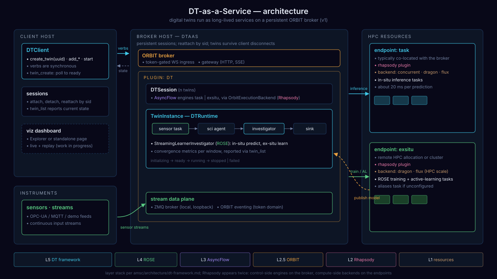

# RADICAL Doppelganger

Doppelganger runs **digital twins as a service** (DTaaS).  A digital twin
here is a graph of components that consumes a live data stream, serves
predictions from a model, and keeps that model current while it runs.
The service keeps twins running after their client disconnects and runs
their expensive tasks on HPC resources.



The same twin code runs in two places:

- **in your own process**, with no service and no HPC.  This is how you
  build and test a twin.
- **on the service**: the client ships the component classes to a
  broker that hosts the `dt` plugin, and the twin's tasks run on
  endpoints, on a laptop or on an HPC machine.

!!! note "Status"
    Doppelganger is a research prototype (v1).  Read
    [Status and limits](overview/status-and-limits.md) before you rely on
    it for anything shared.

## Where to start

| You want to | Read |
|---|---|
| build a twin and wrap your own surrogate model | [Install](build/install.md), then [Your first twin](build/first-twin.md) and the rest of *Build a twin* |
| drive a running service from your code | [Service guide](use/service.md) |
| understand how the layers fit together | [The stack](overview/stack-map.md) |
| see what v1 does and does not do | [Status and limits](overview/status-and-limits.md) |
| work on Doppelganger itself | [Develop](develop/docs.md) |

## Twenty lines of twin

A sensor publishes readings, a surrogate predicts from them, and a sink
consumes the predictions:

```python
runtime = DTRuntime(flow, stream)

runtime.add_task(Sensor(flow), TRUTHY, READING, is_persistent=True)
runtime.add_investigator(Surrogate(flow), READING, PREDICTION)
runtime.add_task(Sink(flow), PREDICTION, NULL_DTYPE)
runtime.start()

answer = await runtime.get_inference(TypedData(READING, 1.5), PREDICTION)
```

The full, runnable version is `examples/surrogate/`, and
[Your first twin](build/first-twin.md) walks through it.
